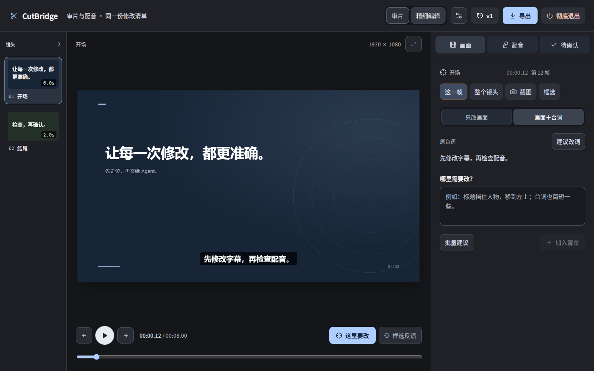
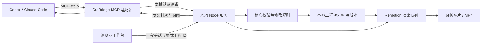

<p align="center">
  
</p>

<p align="center">欢迎关注微信公众号「海绵朋克」，交流 AI 产品、Agent 工具与开发实践。</p>

# CutBridge

**把人的判断，准确带回 Agent 视频创作。**

CutBridge 是通过 Codex 或 Claude Code 使用的本地视频审片工作台。Agent 负责制作视频和提出修改，人通过可视化界面定位画面、台词与配音的问题，把多个位置的建议一次送回 Agent，再预览、试听和确认结果。

当前为 **0.2.5 源码体验版**：需要本地 Node.js/npm 环境和可使用 MCP 的 Agent。Windows 是主要验收平台；Linux 有 Ubuntu/WSL2 专项结果，macOS 尚未实机验收。工作台没有内置聊天模型或 TTS 服务，也没有脱离 Agent 的独立新建工程入口。

Windows 工作台后台由本地 WMI 创建隐藏进程，独立于发起它的 Agent 进程组，避免宿主回收进程时连带关闭工作台。不安装系统服务或计划任务、不修改系统权限。WMI 被系统策略禁用时明确报告启动失败，不会假装成功打开。升级涉及 MCP 启动代码时，需要让宿主重新加载 MCP，已经驻留的旧进程不会自动换成新代码。

安装目录建议放在 `%USERPROFILE%/CutBridge/app` 等普通用户目录，视频保存在你指定的另一文件夹。部分打包版宿主会把 AppData 写入映射到自身私有缓存；安装器使用真实路径检测并拒绝这类位置，避免 Codex 内能读取、独立后台或另一个 Agent 却找不到同一份文件。



## 阅读导航

- [产品解决什么问题](#产品解决什么问题)
- [功能与完整操作流程](#功能与完整操作流程)
- [安装与接入](#安装与接入)
- [多个对话与多个工作台](#多个对话与多个工作台)
- [架构与运行原理](#架构与运行原理)
- [工程文件与数据模型](#工程文件与数据模型)
- [反馈与修改规则](#反馈与修改规则)
- [配音如何返工](#配音如何返工)
- [渲染与后台生命周期](#渲染与后台生命周期)
- [MCP 工具接口](#mcp-工具接口)
- [安全与隐私边界](#安全与隐私边界)
- [测试与开发](#测试与开发)
- [常见问题](#常见问题)
- [当前边界与后续方向](#当前边界与后续方向)

## 产品解决什么问题

Agent 可以生成视频初稿，但用户常常难以在聊天中准确描述“第几帧的哪个区域需要改”，也难以说明画面修改与台词、声音之间的关系。截图、时间码和零散聊天还容易丢失原版本上下文。

CutBridge 把审片反馈保存为结构化任务：每条建议带有工程、版本、对象、帧位置、可选画面区域和台词上下文。Agent 读取这些信息和原版本图片后提出修改；修改不会立即覆盖用户正在观看的版本。

工作台的主线是**发现问题 → 精准定位 → 汇总建议 → Agent 修改 → 人工确认**。复杂剪辑、镜头运动、转场、配音生成由外部 Agent 使用其工具完成。界面只保留少量人工画面微调，并要求点击确认后正式保存。

### 适合的场景

- AI 内容创作者审查由 Agent 制作的短视频。
- 教程和产品演示中，定位某个按钮、标题、字幕或口播问题。
- 对初稿做局部返工，而非重新描述和生成整条视频。
- 在 Codex、Claude Code 或不同聊天之间接续同一份工程。

## 功能与完整操作流程

| 环节 | 用户操作 | 系统与 Agent 做什么 |
| --- | --- | --- |
| 创建或继续 | 在 Agent 中指定视频文件夹和需求 | Agent 建立工程或发现已有工程，返回工作台入口 |
| 审片 | 播放、暂停、逐帧定位、选择台词 | 工作台保持当前位置与工程对象的对应关系 |
| 标记画面 | 点击“这里要改”，可截图或框选 | 建立原版本、镜头和帧位置锚点 |
| 标记配音 | 在“配音”中选择一句话，试听并写建议稿 | 保留原台词，记录建议文字和允许修改的范围 |
| 批量发送 | 多处建议加入一份清单，一次发送 | 工程内生成反馈批次，交给当前负责的 Agent |
| 修改 | 在 Agent 中处理反馈 | Agent 读取原图和上下文，提交结构化提案 |
| 审查 | 预览画面，比较新旧声音，接受或拒绝 | 接受后才生成正式版本；拒绝保留原内容 |
| 验收 | 回放后确认问题已解决 | 用户决定反馈是否结束，Agent 不能替用户验收 |
| 导出 | 导出当前已保存版本 | 后台真实渲染 MP4，保留可编辑工程 |

### 第一次使用

完成安装后，在 Codex 或 Claude Code 中选定一个素材文件夹，说：

> 用这个文件夹中的素材制作一条产品演示视频，并打开 CutBridge 工作台。

已有工程可以直接说：

> 打开这个视频的剪辑工作台。

工作台打开后：

1. 播放初稿，停在有问题的位置，点击 **这里要改**。
2. 填写建议，例如“这个标题遮住了按钮，向上移动一点”；需要时框出区域。
3. 打开 **配音**，选择一句台词，试听并填写建议稿。
4. 选择 **只改画面**、**只改台词／配音**或**画面＋台词**，避免 Agent 扩大修改范围。
5. 把建议加入同一清单，点击 **发送给 Agent**。
6. 已绑定的 Codex 桌面或已连接自动接收 Hook 的 Claude Code 自动收到这批建议并接续，无需追加「处理反馈」。宿主故障时界面保留建议并显示待送达。
7. 在 **待确认** 中预览修改、试听新旧配音，满意后点击 **接受修改**。
8. 回放确认后，标记问题已解决，按需导出 MP4。

批量文本输入采用每行 `分:秒.帧｜建议`，例如：

```text
00:02.15｜这个标题向上移动，只改画面
00:06.00｜这句说得太长，缩短台词并重新配音
```

工程固定为 30 fps，末两位是 **0–29 的帧号**，不是小数秒。每条建议独立定位，并保留自己的修改范围。

## 安装与接入

### 运行条件

- Windows 为主要体验平台。
- Node.js **22.12+** 和 npm；需要代理下载依赖时使用 Node.js **22.21+ 或 24.5+**。
- 可使用 MCP 的 Codex 或 Claude Code，并已完成相应宿主的登录配置。
- 首次安装需要网络，用于 npm 依赖和渲染浏览器下载。
- 配音生成需要 Agent 自己可用的外部 TTS 工具；CutBridge 不提供声音服务密钥。

从本仓库 **Code → Download ZIP** 下载并完整解压，或使用 Git：

```powershell
git clone https://github.com/YeeKuson/CutBridge.git
cd CutBridge
npm ci --cache .tmp/cutbridge/npm
npm run build
```

在固定的安装目录完成接入，选择实际使用的宿主：

```powershell
# 只查看将写入的位置
npm run setup -- --host both

# 接入 Codex 和 Claude Code
npm run setup -- --host both --apply
```

只使用一种宿主时，把 `both` 改成 `codex` 或 `claude`。安装完成后重开宿主会话，让它发现新的 MCP 工具和 Skill。

日常使用应从发布包解压到固定安装目录，再注册该目录中的 MCP；不要把正式宿主指向持续修改的开发副本。更新时先退出旧工作台后台，再安装依赖、构建和更新宿主接入。MCP、后台和页面版本不一致会明确报错；入口 HTML 不长期缓存，避免继续引用旧页面。

### 安装器实际做了什么

1. 检查构建产物、宿主配置和同名 Skill 是否存在冲突。
2. 在软件安装目录准备 Remotion 使用的渲染浏览器；下载进度显示在终端。
3. 渲染依赖成功准备后，才写入宿主 MCP 配置和可发现的 Skill。
4. 既有配置先保留相邻备份；通过安装记录管理自己的配置，不覆盖其他来源的同名内容。
5. 重复运行时不重复追加配置；人工修改过受管理内容会被明确拒绝覆盖。

不带 `--apply` 的预览不会下载浏览器，也不会写宿主配置。下载失败保留原配置，修复网络或代理后重新运行即可。安装器只在自己的进程中使用已有 `HTTP_PROXY`、`HTTPS_PROXY`、`NO_PROXY`，不会修改系统代理。

| 宿主 | 默认 MCP 配置位置 | 默认 Skill 位置 |
| --- | --- | --- |
| Codex | 用户目录的 `.codex/config.toml`，遵循受支持的 `CODEX_HOME` | 用户目录的 `.agents/skills/cutbridge/` |
| Claude Code | 用户目录的 `.claude.json` | 用户目录的 `.claude/skills/cutbridge/` |

自定义 Claude 配置目录时，安装器会要求按该目录手动接入。不要把别人的绝对路径直接复制到自己的配置。

### 自动接续与切换对话

Agent 打开浏览器及回复的工作台链接都必须使用 MCP 返回的完整授权地址。系统浏览器与聊天侧边预览不共享 Cookie；同一链接在 10 分钟内可分别打开，使用不会延长有效期。加载成功后地址栏自动移除凭据，此时可收藏；收藏地址仅适用于已授权的该浏览器，不能用于另一浏览器的首次打开。

临时断网或读取超时会自动重试，工程和草稿保留。HTTP 异常显示状态码；授权失效会明确提示使用 Agent 返回的完整链接，后台重启后须取得新链接。

在任意新对话说「打开这个视频的工作台」或「接管这个视频」，Agent 显式打开后自动成为负责人，已有页面无需关闭。尚未领取的已提交建议会自动续送；旧对话失去领取和提案权限。不同视频可分别绑定不同对话，普通查看不会抢走绑定。

Codex 桌面依赖宿主随附的 `codex-app-tools` 消息工具。安装器传递宿主提供的 `CODEX_APP_TOOLS_PIPE_PATH`；MCP 每次调用优先读取 `_meta.threadId`，避免新聊天沿用旧进程身份。不要手工填入其他聊天的 UUID，不要清空会话环境。缺失可靠身份时打开失败，由 Agent 使用标准适配器恢复；不会假装已经绑定。桌面使用原生消息入口，CLI 使用 queue；仅有 CLI 入队回执不代表桌面已收到。

Claude Code 照常使用 `claude` 启动，在对话里说「请调用 CutBridge，将打开的视频工作台绑定到当前对话」即可；每批建议无需再输入文字，也无需 channel 启动参数。安装器会在用户 `.claude/settings.json` 合并三个本地 Hook，并保留其他设置与备份：PostToolUse 用本次打开凭据和宿主 session_id 注册通知，Stop 在后台等待用户已提交建议并通过 asyncRewake 唤醒原对话，SessionEnd 清理注册。没有建议时不调用模型。

工程负责权和自动接收分别确认：Hook 成功后界面显示「当前 Claude 对话 · 自动接收」，MCP 返回的 `agentOwner.notification` 为 `ready`。缺失 Hook、禁用 Hook 或注册失败不得宣称自动接收已成功。升级后重新启动 Claude 加载更新配置；正常使用仍只需一句话绑定。此入口要求支持 `args` 和 `asyncRewake` 的 Claude Code，当前验收版本为 2.1.316；非交互 `-p` 退出后不能继续接收。参见 [Claude 官方 Hook 说明](https://code.claude.com/docs/en/hooks#run-hooks-in-the-background)。

单条建议的删除在该按钮旁浮动确认；批量删除在清单顶部统一确认。两者只删除建议记录，不撤销已接受的视频版本。

### 手动配置

运行下面的命令可生成与当前安装位置匹配的配置：

```powershell
npm run setup:print
```

结构示例在 [integrations/codex.example.toml](integrations/codex.example.toml) 和 [integrations/claude.mcp.json](integrations/claude.mcp.json) 。其中 `/absolute/path/to/cutbridge` 必须替换成实际安装目录；安装器生成的路径可避免手工填写错误。

两个宿主应连接**同一个软件安装和本地服务数据目录**。如果自定义端口或数据目录，要在两边的 MCP `env` 中一致设置，不能只依赖启动宿主前的 shell 环境。

| 环境变量 | 用途 |
| --- | --- |
| `CUTBRIDGE_HOST` | 明确宿主为 `codex` 或 `claude` |
| `CUTBRIDGE_PORT` | 本地服务端口，默认 `4318` |
| `CUTBRIDGE_DATA` | 本机工程索引、认证及服务状态目录，默认安装目录下的 `data/` |
| `CUTBRIDGE_CODEX_PATH` | 为宿主通知适配器指定 Codex 可执行文件 |
| `CODEX_THREAD_ID` / `CODEX_SESSION_ID` | 宿主提供的当前对话标识，用户无需手工填写别的聊天 ID |

### 安装目录与视频目录

软件只需在固定位置安装一次。每条视频放在自己的目录，素材、工程和导出不必放进软件源码目录。不要将软件安装目录误当成当前视频目录传给 Agent。

新工程主文件可直接建在用户指定的视频目录根部；打开旧工程时，先检查根主文件，再发现一级子目录或旧 `data/<projectId>` 布局。多个候选由用户选择，系统不猜“最近的一条”。只有 MP4、没有工程主文件的文件夹，不会被当成可反向恢复的剪辑工程。

## 多个对话与多个工作台

| 情况 | 规则 |
| --- | --- |
| 两个对话分别打开不同视频 | 各自负责自己的工程，可多开工作台，反馈与提案按工程隔离 |
| 两个对话打开同一个视频 | 最后一次**显式打开**的 Agent 对话获得负责权 |
| 原对话只读取工程 | 普通读取不抢占负责人 |
| 浏览器刷新 | 不改变 Agent 负责人 |
| 原负责人继续领取或修改 | 返回会话已被替换，不能自动抢回工程 |
| 关闭一个浏览器标签页 | 其他页面、Agent 操作和后台导出继续 |
| 点击“彻底退出”并确认 | 停止整个 CutBridge 服务，断开所有工作台，取消全部未完成导出 |
| 服务重启或更换浏览器 | 从 Agent 重新打开工程取得授权，工程和正式版本保留 |

多开共用一个本地后台。不同工程的绑定互不替换，渲染任务按队列执行。当前不提供多人云端协作，也不承诺两个独立服务对同一工程实时合并。

## 架构与运行原理



### 技术栈与目录职责

| 路径 / 技术 | 职责 |
| --- | --- |
| `src/core/` / TypeScript、Zod | 工程类型、输入校验、编辑操作、保护与版本规则；不依赖浏览器和文件系统 |
| `src/server/` / Node.js | 本地 HTTP、工程持久化、媒体访问、会话负责人、MCP、后台渲染 |
| `src/web/` / React、Vite | 播放、定位、反馈清单、建议稿、提案对比、人工确认 |
| `src/video/` / Remotion | 浏览器预览和导出共享的 composition |
| `skills/cutbridge/` | 给外部 Agent 的创建、制作、反馈和提案操作规则 |
| `integrations/` | 两种宿主的 MCP 配置结构示例 |
| `tests/` | 核心规则、工程与服务状态、失败路径回归 |
| `scripts/` | 安装、固定依赖补丁及隔离验证 |

依赖版本以 `package-lock.json` 为准。核心渲染库固定为 Remotion 4.0.539；安装后会应用经过版本检查的必要补丁，覆盖 Windows 隐藏后台进程和浏览器下载错误传播。升级依赖不能跳过补丁检查与渲染回归。

### 一次操作经过哪些步骤

1. Agent 通过 MCP 显式打开工程，获得当前服务内的工程负责凭据。
2. 用户在浏览器操作时，请求同时带明确的工程 ID 和该工程专属会话。
3. 服务端校验权限、输入结构、基础版本、保护字段及反馈修改范围。
4. Agent 提案存入待确认列表，当前正式 composition 保持不变。
5. 用户接受提案后，核心规则计算新 composition，保存新版本。
6. 浏览器同步最新状态；导出任务使用指定已保存版本的快照。

同一套编辑规则服务于 Agent 和人工修改，避免前端能通过、后端却另有一套解释。人工微调先保留草稿，点击确认才正式保存，避免每次拖动都触发持久化或让 Agent 处理半成品状态。

### 保存与并发

每次正式修改必须声明 `baseRevision`。发现新版本时拒绝旧修改，不用“最后写入覆盖”处理编辑冲突。`requestId` 用于识别完全相同的重复请求；相同 ID 配不同内容不能冒充重试。

磁盘保存采用独占写锁、文件指纹比较和临时文件替换。服务级互斥在读取工程前建立，Windows 使用命名管道、Linux 使用 abstract socket、macOS 预留短 Unix socket 路径。磁盘被外部程序改动时不会静默覆盖；两个服务竞争同一工程时安全拒绝，而非自动合并。

临时残留写锁需要先确认相关服务均已退出并备份工程，再按错误提示处理。程序不会只根据锁文件年龄猜测另一个进程已经停止。

## 工程文件与数据模型

```text
my-video/
├── project.cutbridge.json
├── assets/                 # 导入并复制到工程内的素材
├── feedback/               # 对应原版本的反馈帧图
└── exports/                # 导出的 MP4
```

工程文件的外层格式为：

```json
{
  "format": "cutbridge-project",
  "version": 1,
  "project": { "...": "由 CutBridge 创建和维护的工程状态" }
}
```

这是格式示意，不是可直接导入的完整工程。不要手工拼 JSON 绕过工具校验。

| 字段 | 作用 |
| --- | --- |
| `id`、`revision` | 工程身份及正式编辑版本 |
| `composition` | 镜头、字幕、声音、音乐和画布属性 |
| `assets` | 素材元数据与工程内相对路径 |
| `history` | 版本快照、操作者、说明和具体修改操作 |
| `feedback`、`batches` | 各条定位建议与提交批次 |
| `proposals` | 待确认、已接受、已拒绝的结构化修改 |
| `renders` | 后台导出任务、状态和结果引用 |
| `requestRecords` | 请求幂等记录 |
| `voiceJobs` | 兼容旧配音任务流程的记录 |

软件版本 **0.2.5**、本地 API **v2**、工程格式 **v1** 分别管理。未知文件格式会被拒绝读取，原文件保留，不降级写回。

素材和导出引用使用目录内相对路径。备份或迁移时应保留整个视频目录，单独复制 JSON 不会带上音视频。工程本身可能包含反馈内容、操作者说明和来源目录等元数据，分享工程前应检查。对话负责权与会话绑定只在当前服务内有效，不随工程迁移。

### 当前输入范围

- 固定 **30 fps**，时间采用整数帧。
- 最多 **80 个镜头**、**1,000 条字幕**，全片最多 **18,000 帧 / 10 分钟**。
- 宽、高当前分别限定在 1920 或 1080；常见使用方式为横屏和竖屏 1080p。
- 单个提案最多 100 个结构化操作。
- 请求预校验限制嵌套深度、集合数量和遍历预算，避免无效大输入消耗无限校验资源。

这些是当前实现边界，不代表已完成全部素材编码、最大规模和长期负载组合的验证。

## 反馈与修改规则

每条反馈保存 `baseRevision`、镜头 ID、可选字幕 ID、对象内帧位置、可选区域和原始文字。视频素材被裁剪后会尝试按素材内位置定位；对象被删除或原范围失效时，反馈显示失效，不悄悄移到另一个对象。

`get_feedback` 返回原版本帧、原台词、修改范围、建议稿与声音时长预算，自动附最多 **3 张原生 MCP 图片**。更多画面由 Agent 调用 `inspect_frame`；不会用当前新版画面冒充原反馈画面。


反馈和提案是不同状态：通知发出不表示 Agent 已领取；领取不表示正在生成；提案返回不表示用户接受。接受修改后，是否解决问题仍由用户判断。删除反馈或历史提案不会撤销已接受的版本。

`changeScope` 定义三种修改范围：

| 值 | 含义 |
| --- | --- |
| `visual` | 只改画面，保留台词与已有配音 |
| `dialogue` | 只改定位台词／配音，保留画面和原时长 |
| `both` | 允许协调修改画面与台词、声音 |

Agent 提案须关联处理的反馈 ID，服务端基于修改结果检查范围和保护规则。文本、时间、画面和声音可分别保护，Agent 不能自行解除保护。范围校验不等于自动理解任意自然语言指令，Agent 仍需阅读用户意见。

## 配音如何返工

工作台中的“建议台词”只是待处理建议，不直接修改正式字幕或触发另一条自动配音流水线。

1. 用户选择原句、试听并填写建议稿，说明只改声音或允许联动画面。
2. Agent 读取原台词、建议文字、时段预算和已有声音要求。
3. Agent 使用自己的外部 TTS 工具生成真实音频，再导入工程。
4. 需要改词时，将 `update_caption` 和 `set_caption_voice` 放入同一个关联反馈的提案。
5. 用户比较旧、新声音和画面，再接受修改。

只改文字而没有新音频时，旧声音保留并标为待重配，不把“改字”显示成“已完成配音”。音频超过字幕时段会被拒绝，不能静默截尾、加速或改动画面节奏。两句配音重叠、文本过期、声音受保护同样需要解决后重新提交。

文本对应关系用于追溯版本，不是自动语音识别核验。音色与可用 TTS 能力取决于外部 Agent；仓库不包含声音服务密钥或私有语音素材。

## 渲染与后台生命周期

浏览器预览和导出使用相同的 Remotion composition 与参数。成片采用真实 H.264 MP4 渲染；导出任务有 `queued`、`rendering`、`done`、`failed`、`cancelled` 状态，只有输出存在且任务完成时才能交付。

后台排队处理导出；同版本的活动导出请求会复用已有任务。反馈帧图也使用受限队列和缓存，避免多个 Agent 同时截图无限占用资源。素材缺失、渲染失败时保留工程，可根据错误修复后重试。

关闭页面不会停止后台；确认“彻底退出”才会停止 CutBridge 及其未完成导出，不会关闭 Codex、Claude Code 或它们独立运行的配音任务。修复运行依赖或升级程序后，应正常退出旧服务再重开。

## MCP 工具接口

工具通过 `scripts/mcp.mjs` 提供 stdio MCP。以下为接口职责，参数与校验以工具 schema 和源码为准。

| 工具 | 用途 |
| --- | --- |
| `get_capabilities` | 查询软件、API、工程格式及平台能力 |
| `get_recipes` | 读取教程、产品演示、观点短片制作标准 |
| `list_projects` | 列出已登记工程及不可用项 |
| `open_workspace` | 按视频文件夹发现、选择并打开工程，常规入口 |
| `open_project` | 按主文件路径打开工程，兼容入口 |
| `create_project` | 由 Agent 在指定目录创建工程 |
| `open_workbench` | 为已有工程获取授权工作台链接 |
| `bind_session` | 绑定宿主确实提供的当前 Codex 会话 |
| `get_project` | 读取工程、版本、素材、反馈和保护状态 |
| `import_asset` | 导入用户指定的本地素材，复制到工程目录 |
| `get_feedback` | 领取反馈批次并获取原图和台词上下文 |
| `wait_for_feedback` | 在当前 Agent 回合中等待反馈，最多 25 秒 |
| `propose_edit` | 提交待用户审查的结构化修改 |
| `inspect_frame` | 获取指定工程版本的帧图 |
| `render_video` | 提交已保存版本的导出任务 |
| `get_render` | 查询导出状态和成功结果 |
| `get_voice_jobs` | 兼容旧配音任务的领取 |
| `propose_voiceover` | 兼容旧流程的配音替换提案 |
| `report_voice_failure` | 为旧配音任务报告实际失败 |

新界面优先走统一反馈和 `propose_edit`，旧配音工具保留兼容，不要求用户先改正式字幕再请求配音。

Agent 的关键顺序：读取工程 → 领取反馈 → 检查原图及修改范围 → 制作或导入素材 → 基于最新版本提案 → 等待用户审查。遇到 `SESSION_REPLACED` 应停止写入，不能自动打开工程抢回负责权。

## 安全与隐私边界

- 服务仅监听回环地址，默认 `127.0.0.1:4318`，不作为公开网络服务部署。
- 浏览器请求必须显式选择工程，并携带该工程专属会话；服务不回退到最近打开的工程。
- Agent 接口使用本机认证，文件访问受已登记工程与素材边界约束；路径穿越和越界符号链接被拒绝。
- 初次授权链接有时效，不要把链接、Cookie、`agent.key` 或本地会话文件公开。
- 工程文字、字幕、批注和图片是数据，不执行其中的代码，也不将其提升为系统指令。
- CutBridge 不主动上传素材到云端。但 **Agent 读取的反馈、文字或图片可能发送到其模型提供方**；使用前应按宿主和服务商政策判断素材可否发送。
- 此公开仓库只包含程序、测试夹具、文档及明确公开的品牌图片，不包含作者真实视频工程、用户素材、服务密钥、会话日志或内部工作区历史。

项目中的 `.gitignore` 排除运行数据、依赖、构建产物、环境配置和本地 Agent 设置。自己的视频文件夹应单独管理，不要为了演示把完整私人工程提交到公共仓库。

### 已知依赖审计项

0.2.1 将直接及传递 Zod 依赖统一固定为 **4.6.7**，修复此前关联同一 [Zod 大集合校验内存耗尽公告](https://github.com/advisories/GHSA-mrhx-c7xc-m3w5) 的 8 个 high 条目。2026-10-31 对完整依赖树执行官方 registry 审计，结果为 **0 个已知漏洞**，包含开发依赖；这不等于对未知漏洞作出保证。

Remotion 4.0.539 及其 Windows 进程补丁保持不变，`overrides.zod` 与直接依赖使用同一版本，避免嵌套安装旧 Zod。迁移同时保留新工程默认值及局部修改语义：只改标题不会重置位置、音量或字幕样式。HTTP/MCP 输入预算继续生效，工程格式 v1 无需迁移。维护时不要移除 override 后直接发布；先确认依赖树与官方审计，再执行回归。

从 0.2.0 升级时，更新源码后执行 `npm ci` 和 `npm run build`，再正常彻底退出工作台并让 Agent 重新打开。运行中的旧后台不会自动加载新依赖；原有视频目录和工程文件继续保留。

```powershell
npm ls zod --all
npm audit --registry=https://registry.npmjs.org
```

可自行复核当前结果：`npm audit --registry=https://registry.npmjs.org`。部分 npm 镜像没有审计接口，镜像返回 404 不能解释为零漏洞。

## 测试与开发

源码包包含当前已使用的规则测试与关键流程验收入口，不包含内部材料生成脚本。

```powershell
npm ci --cache .tmp/cutbridge/npm
npm run build

# 在隔离 home 准备运行依赖，不改真实宿主配置
npm run setup -- --host both --home .tmp/cutbridge/test-home --apply

npm run check
npm test
npm run verify:mcp
npm run verify:review
npm run verify:render
npm run verify:claude-hook
```

`npm test` 覆盖当前 106 项规则、存储、反馈范围、安装失败和恢复测试，包括超限集合快速拒绝、默认值兼容、局部修改字段保留和私有缓存安装拒绝。浏览器流程在 Windows 优先找 Edge；其他环境可用 `CUTBRIDGE_BROWSER` 指定浏览器，或安装 Playwright 的 Chromium。渲染浏览器与浏览器交互测试使用的浏览器是两个用途不同的依赖。

测试使用独立数据和 4320–4327 端口；同端口脚本不要并行执行。`verify:installation` 需要 `CUTBRIDGE_TEST_INSTALLATION` 指向另一个已安装构建的源码副本，验证从安装配置到双工作台的完整路径。

```powershell
$env:CUTBRIDGE_TEST_INSTALLATION = "<另一个已安装构建的源码目录绝对路径>"
npm run verify:installation
```

开发模式使用 `npm run dev`；生产方式使用 `npm run build` 后运行 `npm start`。日常用户通常由 MCP 按需启动服务，无需保持一个可见终端。开发及测试细节见 [docs/TESTING.md](docs/TESTING.md) 。

### 已有验证与不能据此推断的结论

- Windows 已完成规则测试、浏览器审片、独立源码安装、双工作台隔离和真实 MP4 完整解码。
- 0.2.5 在普通 Claude Code 2.1.316 中实测一句话绑定、两轮连续自动接收、批量原帧领取和待确认提案预览；没有启用 channel 参数或追加处理提示词。
- Codex CLI 与 Claude Code CLI 的真实会话已完成打开、读取各自原帧反馈、提交待确认提案；关闭一页不影响另一页继续确认。
- Ubuntu/WSL2 曾完成后端、MCP、并发和真实渲染专项；不等于原生 Linux 桌面或所有发行版均通过。
- 0.2.2 在 Windows 验证了 Codex 桌面消息接续与 Claude Code 交互 channel：上一轮结束后点击发送，原会话自动读取反馈、提交关联提案，工作台可预览。通知接收、反馈领取和提案接受是不同状态；正常使用仍受宿主登录、权限、网络及模型可用性约束。

## 常见问题

**必须在 Agent 对话里打开吗？** 首次创建和授权通过 Agent。服务运行且当前浏览器仍有工程会话时，可以收藏并返回工程页面；清 Cookie、换浏览器或重启服务后，从 Agent 重新打开。

**为什么发出反馈后 Agent 没有动？** 建议会保留。先检查当前负责对话是否仍在运行，以及工作台是否显示自动接收就绪。Claude 升级接入后须重新启动以加载 MCP 与 Hook，再用原来的一句话绑定；正常使用不需要逐批输入“处理反馈”。模型断网或权限等待仍需在宿主中恢复，传输排队不等于模型已领取。

**换 Agent 会丢视频吗？** 工程保存在本地目录，显式打开同一工程即可接手。新 Agent 成为负责人，旧对话不能继续写入。

**修改建议会立即改变视频吗？** 不会。建议稿是反馈，Agent 提案也要经用户接受才成为正式版本；人工微调同样需要确认。

**可以直接导入一个 MP4 恢复原工程吗？** MP4 可作为素材导入，但不能恢复原来的字幕图层、镜头结构或历史。继续编辑需要原工程目录。

**截图或导出提示渲染浏览器未安装完整怎么办？** 回软件目录重新执行相应宿主的 `setup --apply`，完成后彻底退出并重新打开工作台。工程和反馈会保留。

**出现 `PROJECT_CHANGED`、`PROJECT_BUSY` 或过期版本怎么办？** 检查另一处操作或外部文件修改，保留草稿并重新读取；不要强行覆盖。异常中断留下写锁时，按提示确认服务退出和备份后恢复。

**如何升级或备份？** 正常退出旧服务，备份整个视频目录。在新软件目录安装构建并重新运行接入命令；视频目录可以保留在原位置。不要用旧导出快照覆盖当前工程。

**工程为什么没有音乐添加入口？** 工作台优先审片。配乐制作由 Agent 在需求明确、素材可用时完成；没有配置音乐时隐藏空入口，避免干扰定位。

## 当前边界与后续方向

当前是本地单用户、Agent 驱动的源码体验版。没有内置 AI 聊天、内置 TTS、云端项目同步、完整多轨剪辑器或免环境桌面安装器。

后续扩展可沿宿主通知适配、平台路径与锁、媒体工具、版本化工程格式和持久化边界进行。新增能力应保持原帧可追溯、修改范围明确、过期请求拒绝、用户确认后生效这些约束。当前计划见 [ROADMAP.md](ROADMAP.md) 。

本仓库未附加项目级开源许可证。已携带的字体许可与依赖说明见 [THIRD_PARTY_NOTICES.md](THIRD_PARTY_NOTICES.md) ；第三方组件按各自许可使用。
